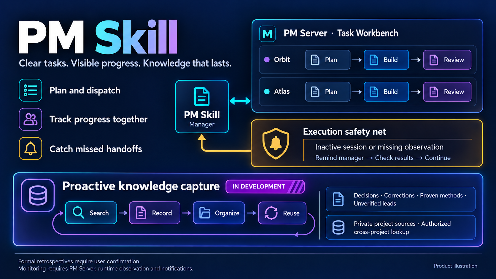

# PM Skill

[English](README.md) · [简体中文](README.zh-CN.md)

**Plan and deliver AI coding tasks with a shared workbench and an execution follow-up safety net.**



Turn a project goal into clear tasks, coordinate independent execution, and accept delivery with evidence. Pair PM Skill with [PM Server](https://github.com/gordonzhy/pm-server) to see progress across projects and bring missed callbacks or handoffs back to the manager's attention. Tasks, decisions and delivery history stay in your repository, so the next session can pick up the work. The knowledge workflow now in development adds a way to preserve useful findings and find them again when a similar question returns.

## What you get

- **Proactive knowledge capture — in development.** Keep useful decisions, user corrections, proven methods and clearly marked unverified leads in authorized private records. Search existing knowledge first, organize within an explicit budget, and return to the source before reusing a finding. `scripts/knowledge.py` supports bounded lookup and rebuildable project partitions; see the [knowledge workflow](references/knowledge.md).
- **Tasks with a clear finish line.** Record goals, ownership, dependencies and acceptance conditions; dispatch work to dedicated execution sessions.
- **A shared task workbench.** With PM Server, view tasks, dependencies, execution observations and delivery evidence across registered projects.
- **An execution follow-up safety net.** Background monitoring flags inactive execution and missing or stale observations, then reminds the manager to check results and coordinate the next step when callbacks or handoffs are missed.
- **Completion backed by evidence.** Preserve task briefs, decisions and structured logs; review implementation and verification before accepting delivery.

## Current progress

**Codex ✅ Ready to try · Claude Code 🚧 Not ready · DSH 🚧 Not ready**

The baseline is the existing Skill management workflow, with optional PM Server for the workbench, observation and reminders. Codex has been verified in actual use; Claude Code and DSH still need platform validation. Native CLI experiments are tracked separately below and do not determine the readiness of this workflow.

✅ Verified usable · 🚧 Not ready. Short notes describe what still needs implementation or platform validation.

| Feature | Codex | Claude Code | DSH |
| --- | --- | --- | --- |
| Install / use | ✅ Verified usable | 🚧 Awaiting host loading validation | 🚧 Awaiting host loading validation |
| Planning / task records | ✅ Verified usable | 🚧 Shared rules; platform validation pending | 🚧 Shared rules; platform validation pending |
| Manager dispatch / continuation | ✅ Verified usable | 🚧 Native collaboration pending | 🚧 Native collaboration pending |
| Delivery / handoff | ✅ Verified usable | 🚧 Awaiting platform validation | 🚧 Awaiting platform validation |
| Shared workbench | ✅ Via PM Server | 🚧 Project display available; host flow pending | 🚧 Project display available; host flow pending |
| Runtime observation | ✅ Via PM Server | 🚧 Event ingress; native Hook pending | 🚧 Cordis observer; host validation pending |
| Exception reminders / manager follow-up | ✅ Via PM Server | 🚧 Awaiting delivery / follow-up validation | 🚧 Awaiting delivery / follow-up validation |
| Evidence / acceptance | ✅ Manager workflow verified usable | 🚧 Awaiting platform validation | 🚧 Awaiting platform validation |

Server features require explicit setup, runtime observation and a configured notification backend. ✅ refers to the manager-led workflow already in use; it does not promise fully unattended execution or every host/version combination. See the [full platform matrix](docs/platform-support.md).

**Experimental additions:** the `0.1.0-rc.8` source includes Unreleased native CLI work. Shared local transactions and worker handoffs are separate from host integration; native continuation/message, strong-host manager handover and native workbench integration remain unavailable. Full unattended real-host delivery is still unverified. See the [CLI contract](docs/cli-contract.md).

## Preserve what you learn — in development

A useful finding should help the next task as well as the current conversation. During an active session, the manager checks existing knowledge before adding a short record with its source, conditions and verification status. Small batches can be organized within an explicit budget; when the same question returns, search a few candidates and read the original records before applying them.

Knowledge stays in authorized private project sources. A rebuildable private cross-project index provides navigation only for explicitly included sources; it does not copy the full records or grant access to other projects. Lightweight tools handle fields, index building, search and consistency checks. The model still judges meaning, evidence and applicability.

Formal retrospectives are a separate step: the manager proposes a scope and budget, then proceeds after user confirmation. An explicit request covering that scope already provides confirmation. Active capture happens during session work; it does not promise scheduled background activity.

This source preview has passed source review and isolated synthetic validation. Installation, real-project use and full model adherence remain unverified; GitHub source availability does not establish those results. The readiness table above describes the established management workflow. The [knowledge guide](references/knowledge.md) documents the preview CLI and its limits.

## Installation

### Install in Codex

Ask Codex's built-in installer:

```text
$skill-installer Install the skill at the root of https://github.com/gordonzhy/pm-skill as project-manager.
```

This is a standard standalone Codex skill; no custom installer is required. You need access to the source repository. For a reproducible install, specify a tag or commit in your request. Then invoke **`$project-manager`** and ask it to help plan your project. If it does not appear, restart Codex. Project tools require Node.js 22+ and Python 3.10+.

See the [setup guide](docs/getting-started.md#install) for standard local placement, existing installations, and Claude Code or DSH setup. The bundled local installer is an optional candidate-update tool with backup and hash checks.

## How the workbench and safety net fit together

1. **PM Skill plans and coordinates.** The manager records tasks and acceptance conditions, dispatches authorized work, and keeps repository records current.
2. **PM Server makes progress visible.** The shared workbench aggregates registered projects while their task files remain the source of truth.
3. **Background monitoring catches follow-up gaps.** With the service running, runtime observation connected and a notification backend configured, inactive execution triggers a reminder to the registered manager; missing or stale observations trigger evidence warnings. The manager checks callbacks and actual results, coordinates continuation or correction, and decides acceptance.

Monitoring runs independently of the browser page. Reminders do not automatically retry a task or mark it complete. PM Server can restart a failed or timed-out monitoring worker within configured limits; a stopped top-level service needs to be started again. PM Skill's basic project tools also work on their own.

[Setup and usage](docs/getting-started.md) · [Management rules](SKILL.md) · [Development](docs/getting-started.md#development-checks)

[MIT License](LICENSE)

The opt-in [deterministic local CLI](docs/cli-contract.md) provides schema discovery, local CSV transactions, consistent snapshots and bounded recovery on supported macOS filesystems. Host execution and workbench integration through this interface remain unavailable.

### Verification tiers

CI selects checks from the changed paths. Documentation and skill rules run isolated installation, product structure, local Markdown link file targets, and installer tests. Ordinary scripts run the Node and Python regressions, including the ordinary file-store tests. Storage, contracts, recovery, installation, CI infrastructure, and unknown changes run the full suite. Deleted and renamed paths participate in selection; unavailable or empty Git baselines select the full suite.

Run `python3 scripts/verify_team_share.py` for the full suite (the default), or explicitly pass `--tier quick` or `--tier regular` for a narrower local check. Regular verification excludes only the eight explicitly named `[stress]` real-process interruption scenarios; their exhaustive checkpoint loops and assertions remain in full verification. Manual workflow runs and the weekly scheduled workflow always run the full suite. A quick or regular result does not establish exhaustive interruption recovery.
