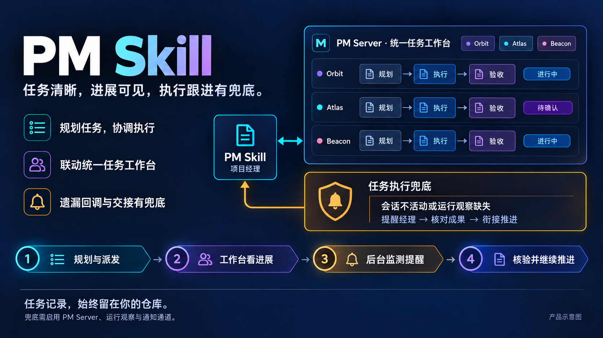

# PM Skill

[English](README.md) · [简体中文](README.zh-CN.md)

**让 AI 编程助手规划任务、协调交付，配合统一任务工作台，为执行跟进兜底。**



把项目目标变成清楚的任务，协调独立执行，用证据判断完成。搭配 [PM Server](https://github.com/gordonzhy/pm-server)，在统一工作台查看多个项目，并把遗漏的回调或交接重新带回经理的关注范围。任务、决策和交付历史留在仓库中，下一个会话也能接着推进。正在开发的知识流程进一步把有用发现留下来，在同类问题再次出现时找得到、用得上。

## 你会得到什么

- **主动知识沉淀——开发中。** 将有用决定、用户纠正、有效方法和明确标注的待验证线索留在已授权的私有记录中。先查已有知识，在明确预算内整理，复用前回读原文核对条件；用 `scripts/knowledge.py` 重建项目分区并检索有限候选，详见[知识流程](references/knowledge.md)。
- **任务清楚，执行有归属。** 明确目标、负责人、依赖与验收条件，派发到任务专属执行会话。
- **统一任务工作台。** 配合 PM Server，集中查看已登记项目的任务、依赖、执行观察和交付证据。
- **任务执行跟进有兜底。** 后台发现执行会话不活动、运行观察缺失或过期时，提醒经理核对成果、衔接下一步，补上遗漏的回调与交接。
- **过程可追溯，验收有依据。** 任务说明、关键决定和结构化日志与代码一起保存，检查实现与验证结果后再接受交付。

## 当前进展

**Codex ✅ 可体验 · Claude Code 🚧 尚未就绪 · DSH 🚧 尚未就绪**

本表以现有 Skill 管理工作流为基线，工作台、运行观察及提醒按需搭配 PM Server。Codex 已在实际使用中验证；Claude Code 和 DSH 仍待平台验证。新版 native CLI 实验单独说明，不用其未完成项否定现有工作流。

✅ 已验证可用 · 🚧 尚未就绪。格内短说明交代仍需补齐的实现或平台验证。

| 功能 | Codex | Claude Code | DSH |
| --- | --- | --- | --- |
| 安装／使用 | ✅ 已验证可用 | 🚧 待宿主加载验证 | 🚧 待宿主加载验证 |
| 规划／任务记录 | ✅ 已验证可用 | 🚧 通用规则具备，待平台验证 | 🚧 通用规则具备，待平台验证 |
| 经理派发／接续 | ✅ 已验证可用 | 🚧 原生协作待接通验证 | 🚧 原生协作待接通验证 |
| 交付／交接 | ✅ 已验证可用 | 🚧 待平台验证 | 🚧 待平台验证 |
| 统一工作台 | ✅ 依赖 PM Server | 🚧 可展示项目，宿主流程待验 | 🚧 可展示项目，宿主流程待验 |
| 运行观察 | ✅ 依赖 PM Server | 🚧 有事件入口，原生 Hook 待适配 | 🚧 有 Cordis 观察器，待宿主验证 |
| 异常提醒／经理跟进 | ✅ 依赖 PM Server | 🚧 待投递及跟进验证 | 🚧 待投递及跟进验证 |
| 证据／验收 | ✅ 经理工作流已验证可用 | 🚧 待平台验证 | 🚧 待平台验证 |

Server 能力须显式接入运行观察并配置通知后端。✅ 指已在用的经理主导工作流，不承诺完全无人值守或所有宿主版本组合；详见[完整平台矩阵](docs/platform-support.zh-CN.md)。

**实验增量／待完善：**标记为 `0.1.0-rc.8` 的源码包含 Unreleased native CLI 工作。通用本机事务和 worker 交接与宿主集成分开；原生续行／传信、强宿主经理换代、原生工作台集成仍不可用；完整真实宿主无人值守交付仍未验证。见 [CLI 契约](docs/cli-contract.zh-CN.md)。

## 把工作中的发现留下来——开发中

一次有用的发现，也应帮助下一次工作。在会话推进过程中，经理先查已有知识，再简短记录来源、适用条件与验证状态；积累后，在明确预算内整理小批条目。同类问题再次出现时，先检索少量候选、回读原文，再判断能否用于当前情况。

知识正文留在已授权的私有项目目录。可重建的私有全局索引只为明确纳入的来源提供跨项目导航，不复制完整正文，也不授予其他项目的访问权限。轻量工具负责字段、索引生成、检索与一致性检查；内容含义、证据与适用性仍由模型判断。

正式复盘单独处理：经理先提出范围与投入建议，用户确认后开展；用户已明确要求同范围复盘时，无需重复确认。主动沉淀发生在有会话触发的工作过程中，不承诺后台周期运行。

此特性为源码预览，已通过源码审查与隔离合成验证；安装、真实项目使用和完整模型遵循仍未验证，GitHub 源码可用不代表这些结果已成立。上方就绪表描述既有管理工作流；预览 CLI 用法与限制见[知识指南](references/knowledge.md)。

## 安装方式

### 在 Codex 中安装

在 Codex 对话中调用内置安装技能：

```text
$skill-installer 将 https://github.com/gordonzhy/pm-skill 仓库根目录的技能安装为 project-manager。
```

这是标准的独立 Codex 技能，无需专用安装器。安装时需要具备源仓库访问权限；需要固定版本时，在请求中指定 tag 或 commit。随后调用 **`$project-manager`**，告诉助手“帮我规划这个项目”。如未出现在技能列表中，重启 Codex。项目工具需要 Node.js 22+ 和 Python 3.10+。

标准目录安装、已有安装的处理及 Claude Code / DSH 配置见[安装指南](docs/getting-started.zh-CN.md#安装)。随包保留的本地安装器用于需要备份、哈希校验的候选更新，是可选工具。

## 工作台与执行兜底怎样配合

1. **PM Skill 负责规划与推进。** 经理记录任务和验收条件，派发已授权工作，持续维护仓库中的任务事实。
2. **PM Server 让进展可见。** 统一工作台聚合已登记项目，任务文件仍是各项目的真源。
3. **后台监测补上跟进缺口。** 服务运行、接入运行观察并配置通知后端后，执行会话不活动会触发向登记经理的核对提醒；观察缺失或过期会触发缺证据警告。经理收到后核对回调与实际成果，协调继续执行或修正，再决定是否验收。

后台检查独立于浏览器页面运行。提醒本身不会自动重试任务或将任务标为完成；监测工作进程退出或超时时，PM Server 可在限定次数内重启它，顶层服务停止后仍需重新启动。PM Skill 的基础项目工具也可独立使用。

[安装与使用](docs/getting-started.zh-CN.md) · [管理规则](SKILL.md) · [开发](docs/getting-started.zh-CN.md#开发检查)

[MIT License](LICENSE)

独立启用的[确定性本地 CLI](docs/cli-contract.zh-CN.md)提供 schema 发现、本地 CSV 事务、一致快照与受限恢复，写入限受支持的 macOS 文件系统；该接口的宿主执行及工作台接入仍不可用。

### 验证分层

CI 按变更路径选择检查。文档和技能规则执行隔离安装、产品结构、本地 Markdown 链接文件目标和安装器测试。普通脚本执行 Node 与 Python 回归，包含常规 file-store 测试。存储、契约、恢复、安装、CI 基础设施及未知变更执行全套。删除与重命名前后的路径均参与判断；Git 基线不可用或差异为空时保守执行全套。

`python3 scripts/verify_team_share.py` 默认仍执行完整验证；本地可显式传入 `--tier quick` 或 `--tier regular` 选择较窄范围。常规验证只排除八个带 `[stress]` 标记的真实进程中断场景；全套保留其全部中断点循环与断言。手动工作流和每周定期工作流始终执行全套。快速或常规验证通过不代表穷尽中断恢复验证通过。

每小时 issue 受理、维护者队列与 Actions 失败跟踪见 [GitHub 运营巡检](docs/github-operations.zh-CN.md)。
